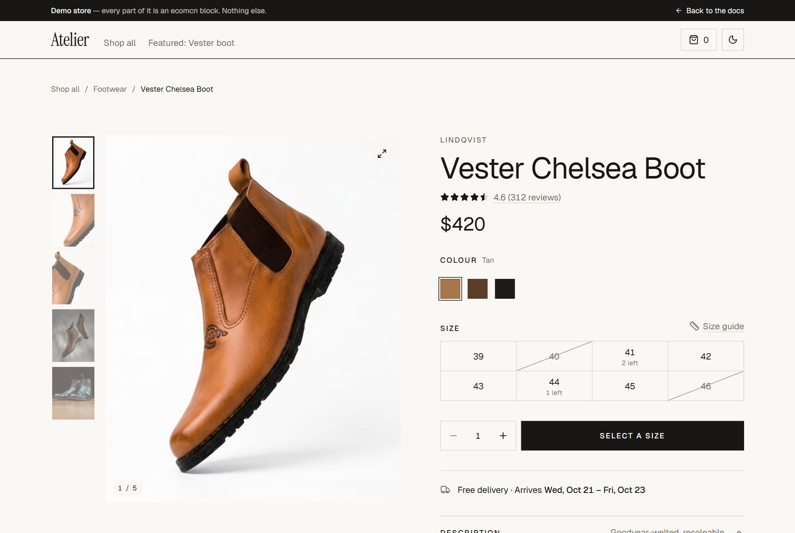
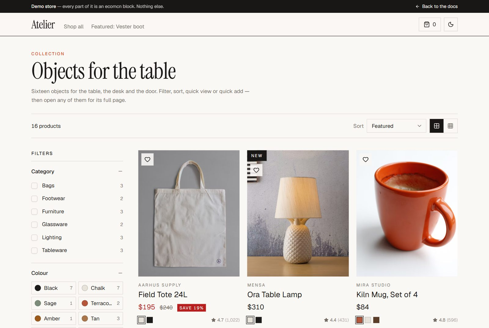
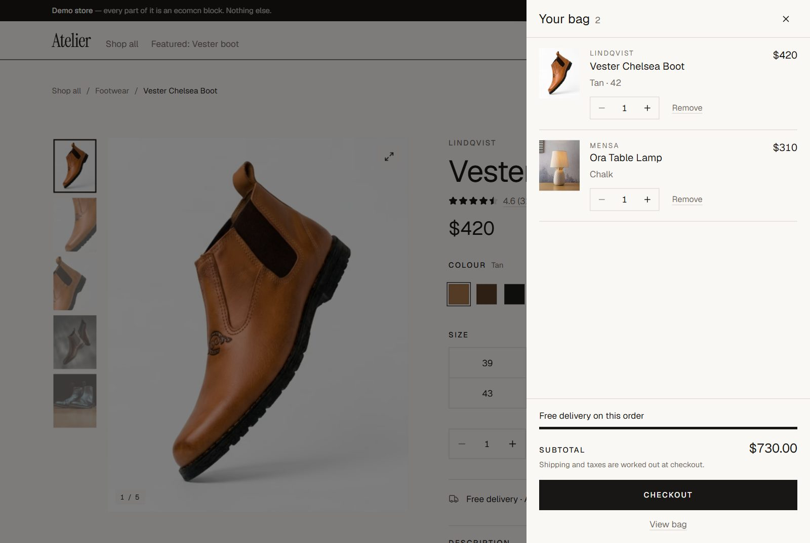
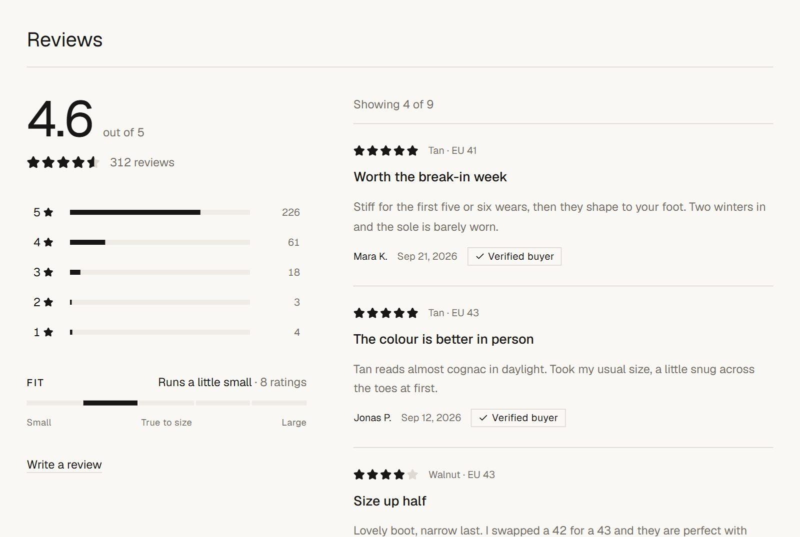
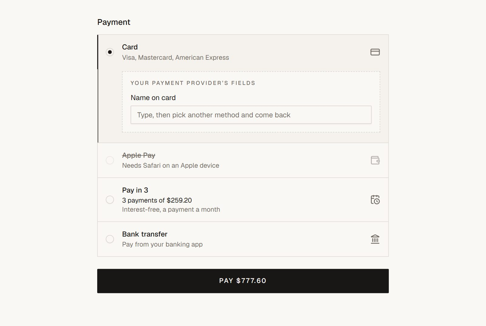

<div align="center">

# ecomcn

**The e-commerce blocks shadcn/ui doesn't ship.**

Buy boxes, faceted filters, cart sheets, order summaries — installed the same
way you install a button.

[Demo store](https://ecomcn.vercel.app/demo) · [Blocks](https://ecomcn.vercel.app/blocks) · [Install](#install) · [Design rules](docs/DESIGN.md) · [Contributing](CONTRIBUTING.md)

</div>

<picture>
  <source media="(prefers-color-scheme: dark)" srcset="docs/screenshots/product-page-dark.jpg">
  
</picture>

---

shadcn/ui gives you ~40 primitives and a handful of dashboard blocks. It has
never shipped a buy box, a faceted filter panel, or an order summary — the
things every store rebuilds from scratch. ecomcn is those things: **25 blocks
that take a shopper from the listing to the parcel at the door**, each one a
file you own, installed with the same command as a button.

The [demo store](https://ecomcn.vercel.app/demo) is built from nothing else —
filter a listing, open a product, add to the bag, check out through address,
delivery and payment, and land on the order confirmation with tracking.

<table>
<tr>
<td width="50%" valign="top">

<picture>
  <source media="(prefers-color-scheme: dark)" srcset="docs/screenshots/listing-dark.jpg">
  
</picture>

**Browse** — [`filter-panel`](https://ecomcn.vercel.app/blocks/filter-panel), [`sort-toolbar`](https://ecomcn.vercel.app/blocks/sort-toolbar), [`product-grid`](https://ecomcn.vercel.app/blocks/product-grid), [`product-card`](https://ecomcn.vercel.app/blocks/product-card)

</td>
<td width="50%" valign="top">

<picture>
  <source media="(prefers-color-scheme: dark)" srcset="docs/screenshots/cart-sheet-dark.jpg">
  
</picture>

**Cart** — [`cart-sheet`](https://ecomcn.vercel.app/blocks/cart-sheet), [`cart-line-item`](https://ecomcn.vercel.app/blocks/cart-line-item)

</td>
</tr>
<tr>
<td width="50%" valign="top">

<picture>
  <source media="(prefers-color-scheme: dark)" srcset="docs/screenshots/review-summary-dark.jpg">
  
</picture>

**Product** — [`review-summary`](https://ecomcn.vercel.app/blocks/review-summary)

</td>
<td width="50%" valign="top">

<picture>
  <source media="(prefers-color-scheme: dark)" srcset="docs/screenshots/payment-selector-dark.jpg">
  
</picture>

**Checkout** — [`payment-selector`](https://ecomcn.vercel.app/blocks/payment-selector)

</td>
</tr>
</table>

Blocks are organised by **the decision a buyer is making**, not by widget type.
That's why you can find what you need by the problem you have.

## Install

ecomcn is listed in the
[shadcn Registry Directory](https://ui.shadcn.com/docs/registry/registry-index),
so blocks install by name — no setup:

```bash
npx shadcn@latest add @ecomcn/product-card
npx shadcn@latest add @ecomcn/order-summary
```

The first add looks `@ecomcn` up in the directory and writes it into your
`components.json`. Blocks that pull other ecomcn blocks resolve on their own —
`product-grid` brings `product-card`, which brings `price-tag`.

Start with the house theme if you want the look from the screenshots:

```bash
npx shadcn@latest add @ecomcn/theme-editorial
```

**Older shadcn CLI, or want the registry pinned in your config?** Register it
yourself once per project, then use the same add commands. `{name}` is
literal — the CLI substitutes the item name.

```bash
npx shadcn@latest registry add @ecomcn=https://ecomcn.vercel.app/r/{name}.json
```

## What you get

- **Motion, with a morph** — the quick view and size guide grow out of what
  opened them, the cart sheet grows out of the bag button, panels grow to
  their real height, and all of it falls back to a fade under
  `prefers-reduced-motion`. `motion` and
  `lucide-react` are the only runtime dependencies, and only on the blocks
  that use them
- **`Intl.NumberFormat` pricing** with `currency` and `locale` props on every
  money-rendering block
- **Loading, empty, out-of-stock and error states** shipped in the same file
- **Keyboard paths for every hover affordance**, and no colour-only state
- **Both shadcn bases** — every block installs and compiles against Base UI
  and Radix, checked in CI on every change
- **Checkout without card data** — `payment-selector` is a slot for your
  provider's own fields (Stripe, Adyen, PayPal) and never renders a card
  number
- **Source you own** — no provider, no config object, no API to fight

## The catalogue

25 blocks shipped, across the four stages from the listing to the parcel at
the door; the Discover stage is planned. Full spec, with per-block design notes and the hard
parts: [`docs/BLOCK-CATALOG.md`](docs/BLOCK-CATALOG.md).

| Stage               | Blocks                                                                                                                                                               | Status  |
| ------------------- | -------------------------------------------------------------------------------------------------------------------------------------------------------------------- | ------- |
| **Browse**          | `product-card` · `product-grid` · `filter-panel` · `filter-sheet` · `sort-toolbar` · `empty-results` · `load-more` · `product-quick-view`                            | shipped |
| **Product**         | `product-gallery` · `price-tag` · `variant-swatches` · `size-guide-dialog` · `product-buy-box` · `product-details-accordion` · `review-summary` · `related-products` | shipped |
| **Cart & checkout** | `cart-line-item` · `cart-sheet` · `order-summary` · `checkout-stepper` · `address-form` · `delivery-options` · `payment-selector`                                    | shipped |
| **Post-purchase**   | `order-confirmation` · `order-tracking`                                                                                                                              | shipped |
| **Discover**        | `announcement-bar` · `hero-editorial` · `category-rail` · `collection-grid` · `lookbook-strip`                                                                       | planned |

Plus `theme-editorial`, the house theme from the screenshots. See the blocks
composed into a [listing page](https://ecomcn.vercel.app/examples/listing-page)
and a [product page](https://ecomcn.vercel.app/examples/product-page), or shop
through the [demo store](https://ecomcn.vercel.app/demo).

## Repo layout

```
registry.json                       root catalogue (include-based)
src/registry/ecomcn/<block>/
  registry.json                     one item file per block
  <block>.tsx                       the source that gets copied
src/lib/utils.ts                    cn()
scripts/verify-install.mjs          installs every block into clean Base UI + Radix apps
scripts/check-registry.mjs          the Registry Directory requirements, as checks
docs/                               catalogue, design rules, publishing guide
.github/workflows/registry.yml      validate → build → typecheck → install test
```

## Develop

```bash
pnpm install
pnpm registry:validate     # schema, duplicate names, include paths, missing files
pnpm registry:build        # emits public/r/*.json
pnpm registry:check        # rebuilds public/r, then checks the directory requirements
pnpm dev                   # site + docs; re-syncs the registry mirrors on every change
pnpm test:install          # installs everything into a throwaway app and compiles
```

Then install into a scratch project and see what an adopter sees:

```bash
npx shadcn@latest add https://localhost:3000/r/product-card.json
```

## Contributing

Read [CONTRIBUTING.md](CONTRIBUTING.md) — especially the six rules. Open a
**New block proposal** issue before writing code.

## Licence

MIT. Anything more restrictive and teams won't clear it with legal, which
defeats the point.

The product photos on the docs site are free [Unsplash](https://unsplash.com)
photos, used under the [Unsplash License](https://unsplash.com/license) and
loaded from Unsplash's CDN. They are not in this repo, not in any registry
item, and not covered by the MIT licence.
